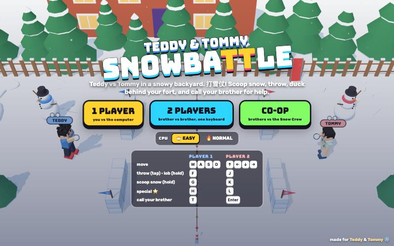

# SnowbaTTle

[](https://adong.github.io/snowball-fight-tt/)

Press **?** any time (or tap the round **?** button on the left edge) to see the keys. The game waits while you look.
Tap the language button under it (the A文 icon) to switch between English and 中文; the dashboard and every game remember the choice.

A snowball fight (打雪仗) starring Teddy and Tommy, in a snowy backyard. It's built with Claude Code from plain JavaScript and Three.js, on the shared Claude Games kit.
There are no image, model or audio files: the kids are the kit's blocky characters, every texture is painted on a canvas, and every sound is synthesised.
It's silly, not mean. Hits go SPLAT! in a puff of snow, three in a row gives you a wobbly "brain freeze" for two seconds (and nobody can hit you while you're dizzy), and the winner does their signature move.
Any time, you can call the other brother in: he runs onto your side, says hi with his signature move, hands you a treat, blocks one hit for you, rebuilds your fort and throws snowballs.

"SnowbaTTle" is a working title. It lives in one place, `js/title.js`.

## Play

- **Double-click `index.html`.** It works offline because Three.js and the kit are copied into `kit/`. Without internet the title font falls back to Arial Black.
- **Send one file:** `dist/snowball-fight-tt.html` is the whole game inlined, about 810 KB. AirDrop or email it, then open it in a browser.
- Rebuild that file after any edit: `python3 kit/tools/bundle.py . --name snowball-fight-tt`

Pick a mode on the title screen:

- **1 PLAYER**: you against the computer. Be Teddy, Tommy or anyone on the roster, against anyone on the roster.
- **2 PLAYERS**: brother against brother on one keyboard.
- **CO-OP**: both brothers on one side against the Snow Crew, a team of snowmen and Bolt robots that gets a bit tougher each round.

A round is **first to 10 hits**, and a match is **best of 3 rounds**. A round also has a 90-second clock: when it runs out, whoever has more hits wins the round, and a tie means "NEXT HIT WINS!" while the forts slowly melt, a brick every 1.5 s, so nobody can hide forever.

The computer has two levels:

- **🐣 EASY**, for little snowballers like Tommy (5): it moves slowly, throws rarely and wide, never dodges, and scoops out in the open.
- **🔥 NORMAL**, for big kids like Teddy (8): it ducks behind its forts, lobs over yours, dodges some throws and grabs power-ups.

## Controls

| | Player 1 | Player 2 | Touch (1 player) |
|---|---|---|---|
| move | W A S D | arrows | the stick |
| throw: tap = fast, hold and let go = lob | F | J | ❄️ THROW |
| scoop snow (hold); a quick tap lobs | G | K | 🤲 SCOOP |
| special ⭐ (tap or hold) | H | L | ⭐ SPECIAL |
| call your brother | T | Enter | his big face button |

- In 1-player mode both key sets control you, so arrows + J K L (and Enter for your brother) work too. Player 2 can also use numpad 1 2 3 0.
- **P** or Esc pauses, and **M** turns the sound on or off. The ❚❚ and 🔊 buttons under the score do the same.
- **Menus:** on the title screen, Enter starts 1 player, 2 starts 2 players, 3 starts co-op, and ← → pick the computer's level. On the select screen, A D change player 1, ← → change player 2 (or the computer), and F or Enter starts. Esc goes back.
- In 2 players and co-op, each player's companion button in the HUD can also be clicked.

## How to fight

- **Scoop snow** by holding G. You crouch down and pat one together every 0.85 s, up to 3. You're slow while scooping, but you're low, so you're harder to hit behind a fort. Your snowballs show as white dots over your head and in the HUD.
- **Throw** by tapping F: a fast, straight throw. **Lob** by holding F and letting go (or a quick tap of G): a high arc that comes down on their head, over the top of a fort. A ring on the snow shows where a lob will land, so you can run.
- **Aiming is automatic.** You throw at the nearest opponent, preferring the one in your lane. A ring under them shows who; it pulses while you hold a lob.
- **Duck** by standing still right behind your fort. Straight throws hit the fort instead and knock off a brick; lobs still drop in. Each fort piece is 3 bricks high and ducking needs at least 2.
- **Hits** score 1 point, or 2 for a giant snowball. Three hits in a row on the same kid gives him a 🥶 **BRAIN FREEZE**: he wobbles for 2 s with stars and snowflakes circling his head, and can't be hit until he's shaken it off. Hitting back clears your streak.
- Two snowballs that meet in the air go **POOF**.

### Power-ups

Every 8 to 11 s a power-up drops onto one side (the sides take turns). Walk over it to pick it up.

| | |
|---|---|
| ❄️ GIANT SNOWBALL | your next throw is a huge one: 2 points, and it smashes a whole fort piece |
| ✌️ TRIPLE THROW | your next 3 throws are 3-snowball fans |
| 🏰 SNOW SHOVEL | your forts are rebuilt, good as new |
| ☕ HOT COCOA | a warm shield for 8 s: snowballs fizz on it |

### Specials

Every hit you land fills your ⭐ meter by a quarter, and getting hit fills it a little. When it glows, tap H for the straight version or hold H for the lob version.

- **TEDDY**:
  - **🥊 BOXING FLURRY** (tap): three quick snowballs, Tyson style, jab, straight, jab. Three hits in a row means brain freeze.
  - **🏀 JUMP SHOT SLAM** (hold): he leaps with a giant snowball over his head and dunks it. It lands for 2 points, splashes anyone close by, and knocks two bricks off any fort nearby.
- **TOMMY**:
  - **✌️ PEACE SPREAD** (tap): he turns to the camera and strikes his Y pose (比耶), then sends two fans of 5 snowballs.
  - **✌️ PEACE RAIN** (hold): the same, but the snowballs are lobbed and land in a ✌️ V around the target.
- **ZOOM** 💨 zoom flurry (4 quick throws), **LUNA** 🌙 moon rain (lobbed fans), **BOLT** ⚡ snow cannon (two giant fast ones), **BRUNO** 🐻 bear slam (a giant dunk), **ZOMBIE** 👻 boo-balls (two fans of 3). The Snow Crew's snowmen have ⛄ avalanche (a giant dunk).

## Call your brother (companion mode)

Your companion is the other brother: **Tommy** comes for Teddy and everyone else, and **Teddy** comes for Tommy. If he's already playing (2 players, co-op, or when you're fighting him), a friend from the roster stands in: Zoom, then Luna, then Bruno. The select screen shows who you'll get ("+ buddy TOMMY").

- **Calling him:** press T (player 1), Enter (player 2), or tap his big face button. He runs in from the back of your yard and:
  - says hi with his signature move: **Teddy** shadow-boxes (BOP!), **Tommy** does his Y pose (PEACE!), the others wave;
  - hands you a treat, which flies over as an emoji: 🍦 💧 🧃 🍪 🍉 🍌 with a toast like "🍦 ICE CREAM FROM TOMMY!". Each treat comes with a snowball;
  - **blocks one hit** for you while he's there: a yellow ring glows at your feet, and when a snowball would hit you it's "TOMMY SAVED YOU!";
  - **rebuilds your fort** with a little red shovel if it's been chipped, otherwise he throws snowballs at the other side (his hits count for you);
  - goes home after about **10 s**, waving goodbye (Teddy with a jump shot).
- His face in the HUD has a ring that runs down while he's there. **Tap again while he's there for another treat** (one every 1.5 s, and it keeps him for the full 10 s).
- **In 1 player and co-op** you can call him as often as you like, straight away again after he leaves.
- **In 2 players** each player calls his own, and he stays 8 s and then rests for a bit (18 s from the call, shown as "RESTING") so it stays fair.

## The screen

- **Top:** each side's faces, names, snowballs (white dots), power-up, ⭐ meter and companion button, and the score in the middle with round stars ★ and the clock. In co-op each side shows both of its players.
- **Over the yard:** name tags (blue for the left side, red for the right) with snowball dots, rings under whoever you're aiming at, lob landing rings, and comic bursts (SPLAT!, POOF!, BOINK!, SAVED!, FSSS!, BRRR!, WHUMP!). Snowballs have a dark rim so they show up against the snow.
- **Touch:** a stick on the left and THROW / SCOOP / SPECIAL buttons plus your brother's face on the right. They show up in 1 player as soon as you touch the screen.

## Make it yours

- `js/engine.js`, `TUNE` at the top: speed, scoop time, throw speeds, lob arc, hits to win, round time, dizzy time, power-up timings, companion time and rest.
- `js/engine.js`, `SPECIALS` and `CHARS`: what each special does (shots, fan, giant, lob, jump) and who has which. `COOP_WAVES` is the Snow Crew line-up per round. `TREATS` is the treat list.
- `js/cpu.js`, `LEVELS`: the computer levels, plus two test bots (`kid`, `bigkid`) that aren't in the menus.
- The looks come from the kit roster, so a new kit character (say, Dad) needs one line in `CHARS` and one in `ROSTER` at the top of `js/game.js`.

## How it works, and how it's tested

- The engine (`js/engine.js`) has no Three.js and no DOM. A match is plain state stepped at a fixed 60 ticks a second, and the same code runs the browser game and the headless tests. CPU players (`js/cpu.js`) return the same kind of action a human's buttons turn into.
- The renderer (`js/game.js`) only reads match state, and turns the engine's events into splats, sounds, toasts and banners. A CPU-vs-CPU demo with companions plays behind the menus.
- **Headless runner:** `node tools/soak.js` plays whole matches in node with the real engine and CPU code, no browser:

```bash
node tools/soak.js 200
```

```bash
node tools/soak.js 10 --maxRound 5
```

```bash
node tools/soak.js 300 --versus kid,normal --calls
```

The first runs 200 random 1P / 2P / co-op matches with companions called now and then: every round must finish, nobody may leave the yard, nothing may turn into NaN, and it exits with status 1 otherwise. The second proves the check can fail (every round longer than 5 s is reported). The third gives win counts for one level against another, and `--calls` makes the left player call his brother every 6 to 14 s.

- At the last check:
  - 200 random matches (103 1P, 58 2P, 39 co-op) all finished: 443 rounds, median round 59 s, longest 113 s.
  - Before the forts melted in sudden death, 2 of 4,000 matches between two careful players had a round still tied after 150 s. With melting, 4,000 more matches all finished, the longest round at 130 s.
  - A "little kid" bot (runs around, mashes throw, never takes cover, with the human aim help) beat Easy 300 of 300, scoring about 19 hits a match to Easy's 6.
  - A "big kid" bot (hides behind forts, lobs, rarely dodges) beat Normal 107 of 300 on his own. Calling the brother is a big help: the little-kid bot calling him every 6 to 14 s beat Normal 258 of 300.
  - Teddy vs Tommy at the same CPU level is even: 49 to 53% for Teddy across runs of 600 to 1,600 matches, alternating sides.
- In the browser, `window.game` has test hooks:

```js
game.start({ mode: '1p', p1: 'teddy', p2: 'tommy', level: 'easy' })  // jump straight into a match ('1p' | '2p' | 'coop')
game.step(2)          // advance 2 s and draw (for when the tab's animation is throttled)
game.ff(10)           // advance 10 s, drawing only the last frame (fast in a hidden browser pane)
game.buddy(0)         // call player 0's companion
game.special(0, true) // fire player 0's special now (true = the hold version)
game.throw(1)         // make player 1 throw
game.give(0, 'giant') // hand player 0 a power-up: giant | triple | shovel | cocoa
game.set(1, { hold: true, x: 5, z: 0 })  // move player 1 and keep a CPU still (for staged screenshots)
game.state()          // a summary of the match
game.soak(50)         // the headless soak, in the page
```

## Files

```
index.html       page, HUD, menus, touch controls (CSS inline)
js/title.js      the game's name, in one place
js/engine.js     the rules: yard, forts, scooping, throws and lobs, hits, brain freeze, power-ups, specials, companions, rounds
js/cpu.js        computer players (easy, normal, snowman, robot, test bots) and the headless match runner
js/poses.js      throw, lob, scoop, duck, splat, dizzy, shovel, cheer and aww poses on top of the kit; the Snow Crew's snowman
js/stage.js      the backyard: packed-snow yard, rope line, snow-brick forts, snowmen, pines, fence, house, falling snow
js/fx.js         snow puffs, fort chunks, comic bursts, splats on the snow, rings, flying emoji, confetti
js/sfx.js        snowy sounds on top of Kit.sound: splat, crunch, scoop, brrr, fizz, whistle, fanfare
js/input.js      keyboard for two players, touch stick and buttons
js/game.js       scene, camera, screens, HUD, companions and treats, events, main loop, window.game hooks
js/keys.js       the keys the ? panel shows (Kit.help)
js/zh.js         中文: the page, toasts, banners, the ? panel and the words drawn in 3D (Kit.lang)
tools/soak.js    headless CPU-vs-CPU runner (node)
kit/             copy of ~/claude-games/kit (python3 ../kit/tools/sync.py .), never edited here
dist/snowball-fight-tt.html   the single-page build
```

## Kit candidates

These live in this game's own JS for now. They could move into `~/claude-games/kit` if another game wants them:

- **Poses** (`js/poses.js`): overhand `throw`, underhand `lob` and holding one (`charge`), `scoop`, `duck`, `hit`, `dizzy`, `shovel`, `cheer`, `aww`, with a `drive()` helper that also eases the rig's height and tilt.
- **A snowman on the people rig** (`SBPoses.snowman()`): stick arms, mittens and hat, which every kit pose can drive.
- **Sounds** (`js/sfx.js`): a snow `splat`, crunchy `step` and `scrape`, `freeze` ("brrr"), `shield` fizz, referee `whistle`.

## Not verified

- **Sound**: the synth code runs without errors, but nobody listened to it.
- **Real touch devices**: the stick and buttons (the companion button included) were tested with synthetic pointer events at iPad (1180×820) and phone-landscape (812×375) sizes in the browser pane, not on a real iPad or phone. Two thumbs at once (stick and button) is untested.
- **Double-click from Finder (`file://`)**: the page only uses classic `<script src>` tags and no network requests, but it was tested over `http://localhost`, because the test browser can't drive `file://` pages. The single-file build was checked over `http://localhost` too.
- **Real kids**: difficulty was tuned against bots, not against Teddy and Tommy.
